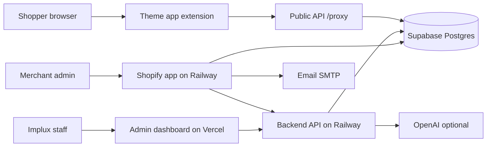

# Implux / Poptek security assessment

**Date:** 11 November 2026  
**Type:** Read-only audit. No application code, data, credentials, or deployments were changed.  
**Audience:** Company leadership and the engineering owners who will approve fixes.

## Overall posture

Poptek is **not ready** to handle additional real merchant or customer data.

The staff tools and the Shopify embedded app show deliberate work: environment markers, a staging guard for local processes, Shopify session authentication, and a compliance webhook that checks Shopify’s signature against the raw request body. Those controls are real. They do not cover the two places where a stranger can reach the most sensitive data.

1. The **production database password was committed to git history** and is still reachable from `origin/main`. Shopify Admin API tokens for installed stores are stored in that database without encryption.
2. The **staging database allows the anonymous Supabase role to read and write every application table**, including the administrator password hash. Row Level Security is off. Staging currently holds almost no merchant data, so this is a loaded configuration more than a current customer-data leak.

Private distribution does **not** remove these risks. A custom or unlisted Shopify app still has to protect access tokens, verify webhooks, honor privacy webhooks when it uses protected customer data, and keep one merchant from reaching another merchant’s records.

## What the system is

Staff operate campaigns from an internal dashboard. Merchants install a Shopify app that stores an offline Admin API token and shows only that shop’s campaign names. The storefront script calls a public API with the shop domain. There is no abandoned-cart database and no customer-email column on campaign events.

## Most serious risks

| Priority | What can go wrong | Status |
| --- | --- | --- |
| Immediate | Anyone who can read git history may still be able to log into the production database. That database holds live Shopify tokens. | Confirmed in git history. Whether Railway still uses that same password was **not** checked, so it must be treated as live. |
| Immediate | The staging database’s anonymous key is not a security boundary. It can read the admin password hash and, once merchants install the staging app, their tokens. | Confirmed in the database. Staging merchant tables are empty today. |
| Before real merchants | The only admin account is created from a short password in `prisma/seed.js`. Login is not rate-limited, and a stolen session lasts 7 days. | Password is confirmed in source. It was **not** compared with the live hash. |
| Before real merchants | Any logged-in staff member can see and change every merchant. The dashboard is not a per-merchant product. | Confirmed in API code. |
| Before real merchants | Privacy deletion does not remove Shopify session tokens, and customer data-request webhooks are only logged. | Confirmed in code. Production currently has **no** stored order ids. |

## Immediate recommendations

Do these before any new merchant install and before copying production data anywhere.

1. **Rotate the production database password** in Supabase and update only the Railway production services. Do not paste the old password into chat, tickets, or new commits. History rewrite is a separate decision; rotation is the part that stops use of the leaked password.
2. **Turn on Row Level Security in staging and revoke anonymous and authenticated grants** on application tables in both staging and production. The application connects as the `postgres` role, which bypasses RLS, so grants to the Data API roles must be removed as well.
3. **Set a new long admin password** and stop running the seed against real databases. Add login rate limiting before the dashboard is exposed more widely.
4. **After the database password is rotated, rotate Shopify offline tokens** if the old database password was never changed after it entered git (14 March 2026). Those tokens can change a store’s theme and read orders.
5. **Do not onboard further live stores** until the P0 items in `SECURITY_REMEDIATION_ROADMAP.md` are done and checked.

## What is working

- Production and staging use different Supabase projects. Staging code refuses a backend URL that points at `api.implux.io`.
- Production Row Level Security is on. An anonymous database query saw **zero** merchant rows while the table contains four merchants. That is default-deny, not a complete design.
- The Shopify embedded app authenticates with Shopify and lists campaigns only for the signed-in shop.
- The mandatory compliance route checks Shopify’s HMAC against the raw body and deduplicates webhook ids.
- Merchant list responses do not return the Admin API token. Rakuten credentials are masked in the admin API.
- No Supabase Storage buckets are public, because there are no buckets. No Supabase Auth users exist. The app uses its own `User` table.

## Finding counts

| Severity | Count |
| --- | --- |
| Critical | 3 |
| High | 7 |
| Medium | 8 |
| Low | 4 |
| Informational | 6 |

Confirmed means the configuration or code was observed. It does not always mean an attacker was allowed to complete the attack. Live password guessing, token theft, and HTTP calls that would download secrets were not performed.

## Private Shopify distribution

Operating as a privately distributed or custom app avoids App Store listing review. It does **not** remove:

- OAuth, session-token, and webhook HMAC requirements for an embedded app.
- Shopify’s protected-customer-data rules if `read_orders` stays in the scopes. Data-request, customer-redact, and shop-redact webhooks still have to do the work, not only return HTTP 200.
- The Partner Program terms, API terms, and merchant privacy obligations.
- The need to delete tokens on uninstall and shop redact.
- Ordinary privacy law duties for whatever customer or staff data is actually stored. Which statutes apply needs legal review; this audit is not legal advice.

`read_orders`, `write_themes`, and `write_script_tags` are broader than the code that ships today. The storefront uses a theme app extension, and campaign “publish” does not call the Admin API. Extra scopes make a stolen token more damaging.

## Reports

| Report | Purpose |
| --- | --- |
| `SECURITY_FINDINGS.md` | Every finding, evidence, and fix test |
| `DATABASE_SECURITY_AUDIT.md` | Supabase, Prisma, and data holdings |
| `SHOPIFY_SECURITY_AUDIT.md` | OAuth, webhooks, merchant isolation |
| `INFRASTRUCTURE_SECURITY_AUDIT.md` | Railway, Vercel, GitHub, dependencies |
| `SECURITY_REMEDIATION_ROADMAP.md` | P0–P3 implementation plan |
| `SECURITY_VERIFICATION_CHECKLIST.md` | Checks required before real merchant data |
| `AUDIT_COVERAGE_AND_LIMITATIONS.md` | What was and was not inspected |
